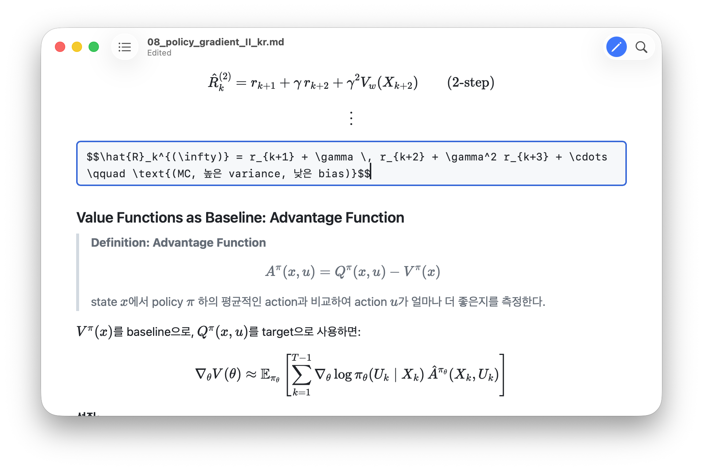
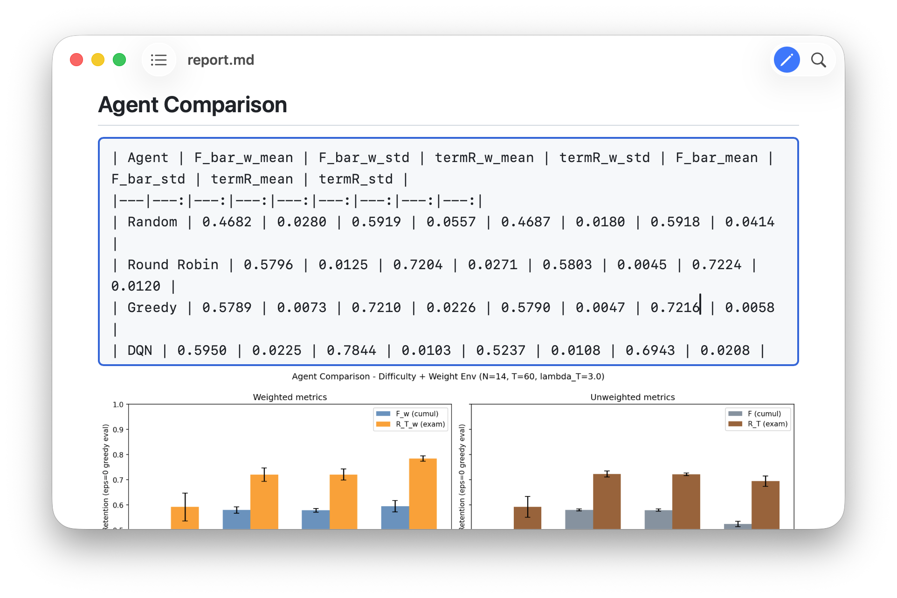

# Bloct

A native macOS Markdown editor with continuous block editing and a rendered reading view.

Current source version: **2.0.5**. Public release status is available on [GitHub Releases](https://github.com/JAEHYEON-BAE/bloct/releases).

<p>
  
  
</p>

## Requirements

- macOS 14.0 or later

## Installation

### Homebrew (recommended - just copy and paste in your terminal)

```sh
brew tap JAEHYEON-BAE/tap
brew install --cask bloct
xattr -dr com.apple.quarantine /Applications/Bloct.app
```

### Manual

1. Download `Bloct.zip` from the latest [Releases](../../releases) page
2. Unzip and drag `Bloct.app` to `/Applications`
3. Run the following in Terminal to bypass Gatekeeper (required once, as the app is unsigned):
   ```sh
   xattr -dr com.apple.quarantine /Applications/Bloct.app
   ```
4. Open Bloct normally from `/Applications`

## Development direction

The top development priority is a Notion-like block editor with continuous visual
editing, semantic blocks and Markdown source preservation. Current behavior, design
contracts, validation and remaining work are tracked in
[F5](IMPLEMENTATION_PLAN.md#f5-notion-방식의-블록-관리와-연속-편집);
[BUG_FIXES.md](BUG_FIXES.md) records defects and their verification evidence.
Click the document to edit at that position; press **Esc** to return to reading.
There is no editing toggle button or formatting toolbar. The same document view, alignment,
scroll position and Undo history remain in place. Unsaved changes stay in memory
until you save.
IME and the remaining feature validation continue under F5.

### Continuous block editing

Edit the rendered document directly in one continuous surface. On an empty text
block, type a marker and Space: `#` through `######` for headings, `>` for a quote,
`-`/`+`/`*` for bullets, `1.` for a numbered list, `[]`/`[ ]`/`[x]` for a task,
three backticks (optionally a language) for code, and `---` for a divider.
`$$` followed by Space stays as text; close a nonempty `$$...$$` expression to
render a block equation. Enter/Shift-Enter may separate its lines before closing.
`$...$` renders inline math. Empty headings and code blocks show a muted placeholder;
ordinary text, quotes and lists stay blank. Every document ends with an available
empty Text line, reusing an existing one without changing the file until edited. Enter
creates the next block; Shift-Enter inserts a hard break in text.
Reading and editing share the same offline KaTeX renderer and fonts. Hover a formula
for a subtle highlight, then click it to edit; Enter/Space also opens the dialog
when the formula has keyboard focus.

In tables, empty cells stay blank. Arrow keys move between adjacent cells at text/line
boundaries. Up from the first row moves before the table, creating a paragraph above
the first document block if necessary. Down from the last row moves after the table,
creating a paragraph after the last document block if necessary. Enter moves to the first cell of the next row; from the last row it creates a
text paragraph below the current table. Tab moves to the next cell. Shift-Enter inserts an empty row immediately below the current
row, including in the middle of a table, and moves the cursor to the first column of the new row.

Changes render while typing; **⌘S** writes a fixed Markdown snapshot. Undo/Redo
uses the same editor history across click/Esc transitions. Closing
a backtick-delimited inline code span returns subsequent typing to plain text.
Unsupported source stays in a protected node with a
read-only source viewer. Actual Korean IME, first-save panels, rich clipboard/PDF,
advanced table/image controls and performance remain under validation; see F5.

## Features

### Editing
Click text to place the caret and edit the continuous document. **Esc** hides the
caret and returns to reading, preserving the draft for **⌘S** or another click.
Typing and Undo/Redo change the document only while editing. Formatting shortcuts
remain available. In an equation/image popup, Esc cancels the popup first; press
Esc again to leave document editing. Esc during IME composition is left to the IME.

### Markdown Rendering
- [GitHub Flavored Markdown](https://github.github.com/gfm/) parsed into semantic editor blocks; protected source previews use [marked.js](https://marked.js.org/)
- Fenced code blocks with language labels
- Tables, blockquotes, and horizontal rules
- Math expressions via [KaTeX](https://katex.org/) — inline `$...$` and display `$$...$$`
- Local images resolved relative to the opened file

### Task Lists
Click a `- [ ]`, `- [x]`, or `- [X]` checkbox to start editing and toggle it once.
While editing, **Tab / Space** also operates task controls. Reading keeps the same shape.
Square checkboxes use the same marker and text columns as
ordinary lists, including nested items and wrapped lines, without an extra bullet.
Each toggle is one Undo step. **⌘S** saves the state to the `.md` file; closing without
saving discards the changes.

### Table of Contents
Toggle the TOC panel with the **⇧⌘T** shortcut or the toolbar button. The panel slides in from the left and updates live as you edit headings.

### Find in Document
Press **⌘F** to open the search bar. Matches are highlighted in the document.
Use **Return** or the next button to advance, and the previous button to go back.
Shift-Return and arrow-key navigation remain unimplemented; see bug 19.

### Export to PDF
Use **File → Export as PDF** to export the rendered document. PDF pagination,
visual drafts and exclusion of interface elements still need acceptance testing;
see bug 11 in [BUG_FIXES.md](BUG_FIXES.md).

### Zoom
Pinch-to-zoom or use **⌘+** / **⌘−** to scale the preview.

### Save
**⌘S** saves changes back to the original `.md` file. A warning is shown if you try to close a window with unsaved changes.

### Reload and External Changes
Press **⌘R** or right-click and choose **Reload** to read the current file from disk.
Files also refresh automatically when changed externally, in both reading and editing,
when there are no local edits. Unsaved edits are preserved: choose **Keep Editing**,
**Discard Edits and Reload**, or **Save a Copy…**. Saving checks for external changes
before writing, so keeping a draft does not authorize overwriting a newer file.

### Scroll Position Memory
The scroll position for each file is restored automatically when you reopen it.

### Dark Mode
Fully adapts to macOS Light and Dark appearance.

## Usage

- Double-click any `.md` file to open it in Bloct
- Drag a `.md` file onto the app icon
- Use **File → Open** from within the app

Bloct declares the `Editor` document role for Markdown and plain text.
`LSHandlerRank: Alternate` retains its existing association priority; document
role and handler priority are separate settings. Choose your preferred default
app in Finder's **Get Info → Open with**.

## Building a release

Builds require Node.js 22.18+ and the locked editor dependencies. Xcode's pre-build
step creates the editor JavaScript, offline CSS/fonts and dependency notices:

```sh
npm ci --prefix Editor
xcodegen generate
```

Release builds also require Xcode 27.0 with the macOS 27.0 SDK and XcodeGen:

```sh
DEVELOPER_DIR=/Applications/Xcode.app/Contents/Developer sh scripts/build-release.sh
```

The shared local/CI script builds a Universal app for Intel and Apple Silicon while
keeping the minimum runtime at macOS 14.0. It rejects a different Xcode/SDK and
verifies the Editor document role and each binary slice before publishing. GitHub Actions uses the `xcode-27`
runner; pushing a new `v*.*.*` tag starts the release workflow.

After a bug fix or feature implementation, a request to commit and push includes
bumping the app version, pushing a new version tag, and verifying the GitHub
Release, published ZIP and Homebrew synchronization. See [AGENTS.md](AGENTS.md).

To verify a downloaded release without installing it:

```sh
python3 scripts/verify-release.py Bloct.zip
```

Homebrew cask updates are handled by the `Sync Bloct` workflow in
[JAEHYEON-BAE/homebrew-tap](https://github.com/JAEHYEON-BAE/homebrew-tap/actions/workflows/sync-bloct.yml).
It checks the latest stable release every 15 minutes, verifies the ZIP SHA256,
and updates its own repository with a short-lived `GITHUB_TOKEN`; no personal
access token is required. GitHub may delay scheduled runs. If GitHub disables
scheduled workflows after a long period of repository inactivity, re-enable the
workflow and use **Run workflow** to synchronize immediately.
