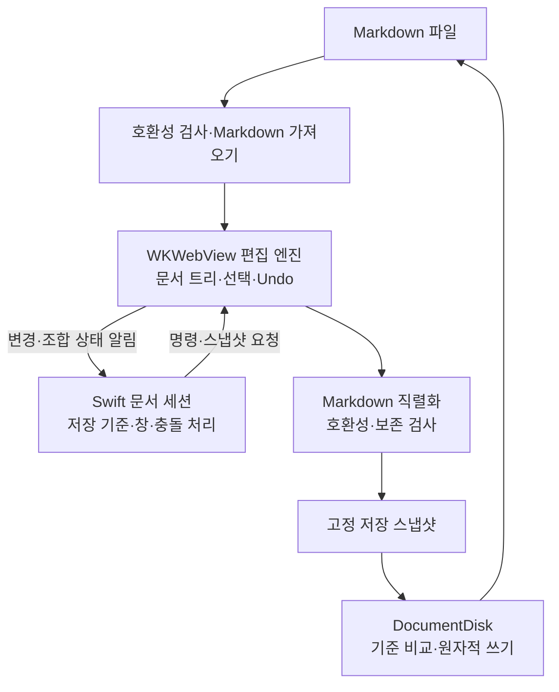

# Bloct WYSIWYG 편집 전환 타당성 분석

작성일: 2026-11-03  
범위: 현재 저장소의 소스·기록 문서 검토와 편집기 공식 자료 조사. 프로토타입, 앱 실행, 성능 측정은 수행하지 않았다. 아래 일정과 권고는 설계 추정이며 구현 검증 결과가 아니다. 이 문서는 최초 타당성 조사 기록이다. 2026-11-03 후속 사용자 지시로 Notion 방식 편집 전환이 최우선 목표가 되었으며 현재 실행 상태는 IMPLEMENTATION_PLAN.md F5를 따른다.

후속 구체화: [Notion 방식의 블록 분할·관리 전환 계획](WYSIWYG_BLOCK_PLAN.md). 블록 단위·빈 줄 호환 경계·ID·원문 대응·입력 명령과 단계별 수용 기준은 해당 설계안을 따릅니다. 미수정 구간 보존을 우선하는 제안으로, 아래 실험용 정규화 허용안보다 보존 계층의 범위가 커졌습니다. 블록 기반 계층부터 구현하며 기존 앱의 기본 편집 경로 교체는 GUI·저장 검증 후 진행합니다.

## 판단

**현실적으로 가능하다. 다만 현재 편집 화면의 부분 수정이 아니라, 편집 엔진과 문서 상태 연결을 교체하는 규모다.** SwiftUI·WKWebView·파일 저장 기반은 활용할 수 있지만, 현재의 줄 배열·블록별 textarea·확정 단위 Undo는 새로운 문서 모델에 맞춰 바꿔야 한다.

권장 방향은 **기존 macOS 문서 앱을 유지하고, WKWebView 안에 검증된 구조화 편집 엔진을 넣는 것**이다. Tiptap을 우선 후보로, Markdown 중심의 Milkdown/Crepe를 비교 후보로 짧게 검증한다. 직접 `contenteditable` 편집기를 만드는 방식은 권하지 않는다. 엔진의 일반 웹 지원이 Bloct의 WKWebView·한글 입력·기존 문법 호환성을 보장하지는 않는다.

| 목표 | 난도·실현 가능성 | 판단 |
|---|---|---|
| 렌더링된 문장에서 바로 입력하고 연속 선택·삭제하기 | 중상 / 가능 | 기존 엔진을 쓰면 핵심 동작을 직접 구현할 필요가 줄어든다 |
| 현재 기능을 유지하는 로컬 `.md` WYSIWYG 앱 | 높음 / 가능 | 변환 호환성, 저장, Undo, IME, 이미지, 출력의 통합 검증이 핵심이다 |
| 수정하지 않은 부분의 Markdown 표기까지 최대한 유지 | 매우 높음 / 조건부 | 원문 위치·공백·구문 표기를 보존하는 별도 계층이 필요하다 |
| 임의의 Markdown·HTML 원문을 완전히 보존하면서 모든 부분을 시각적으로 편집 | 매우 높음 / 첫 목표로 부적합 | 표현할 수 없는 구문에 대한 원문 편집 경로가 필요하다 |
| Notion의 데이터베이스·협업·다단 배치까지 재현 | 별도 제품 규모 | 이번 전환과 분리해야 한다 |

**가장 먼저 결정할 것은 편집기 라이브러리보다 Markdown 저장 계약이다.** 문서의 의미가 같으면 표기 변경을 허용하는지, 공백·목록 기호·체크 표식 등 원문의 형태도 지켜야 하는지에 따라 작업량이 크게 달라진다.

## 목표를 어떻게 해석해야 하는가

Notion도 문단·이미지·표 등을 내부 블록으로 관리한다. 따라서 목표는 내부 구조 자체를 없애는 것이 아니라, Bloct의 **“블록 클릭 → Markdown textarea → 확정 → 미리보기” 전환을 없애는 것**으로 해석하는 편이 정확하다. 화면에서는 문서 전체를 자연스럽게 편집하고, 내부에는 제목·문단·목록·표·수식 등을 구분하는 구조를 유지한다. [Notion의 블록 설명](https://www.notion.com/help/what-is-a-block)

이 분석에서 말하는 WYSIWYG는 다음 경험이다.

- 문단과 제목에 커서를 놓고 표시된 상태에서 바로 입력한다.
- 굵게·기울임·링크 등을 선택 영역에 적용한다.
- 문단 경계를 넘는 선택·복사·붙여넣기·삭제가 가능하다.
- Enter로 문단이나 목록 항목을 만들고, Backspace로 구조를 합친다.
- 표 셀과 체크리스트를 문서 안에서 조작한다.
- 코드와 수식은 전용 편집 UI를 허용한다. 수식의 의미를 마우스로 직접 조작하는 수학 조판기까지 뜻하지 않는다.

슬래시 메뉴와 드래그 핸들은 그 위에 추가할 UX다. 핵심 입력·저장 안정성을 확보한 다음 구현할 수 있다. 클라우드, 협업, 데이터베이스, 페이지 계층은 기본 범위에서 제외한다.

## 현재 구조에서 바뀌는 범위

현재는 JavaScript의 `_mvRawLines`가 원문 줄 배열을 가지고, 빈 줄로 나눈 범위를 `.mv-block`으로 렌더링한다. 입력 중에는 해당 줄 범위를 바꾸고, 편집기를 닫을 때 전체 원문을 Swift의 `DocumentState.commit()`으로 보낸다. 변경된 내용을 다시 렌더링할 때 `#content.innerHTML`을 교체한다. [현재 렌더링·편집 구현](Sources/Bloct/MarkdownWebView.swift)

새 엔진에서는 문서 트리·선택 영역·편집 트랜잭션이 중심이 된다. HTML은 이 상태를 보여주는 결과다. 입력 중 DOM 전체를 다시 만들거나 Swift가 매번 원문을 되돌려 넣으면 커서·한글 조합·Undo가 깨질 수 있다. ProseMirror는 이러한 문서 모델, 선택 영역, 트랜잭션과 변경 이력을 위한 기반을 제공한다. [ProseMirror 구조 설명](https://prosemirror.net/docs/guide/)

| 영역 | 재사용 판단 | 필요한 작업 |
|---|---|---|
| `BloctApp`의 DocumentGroup·다중 창·메뉴 | 대체로 유지 | 편집 명령과 Undo 메뉴를 새 엔진에 연결 |
| `MarkdownDocument`·명시적 Save·쓰기 보호 | 개념과 일부 코드 유지 | 엔진 스냅샷을 새 문서 최초 저장과 기존 파일 저장 양쪽에 연결 |
| `DocumentDisk`의 원본 비교·조정 I/O·원자적 쓰기 | 재사용 가치 높음 | 새 스냅샷·문서 세대와 통합하고 기존 한계도 유지 |
| `ContentView`의 닫기·종료·충돌 UI | UI와 정책 유지 | textarea 존재·dirty 변수에 의존하는 판정 교체 |
| `DocumentState`의 문자열 버퍼·전용 Undo | 역할 재설계 | 엔진 상태와 Swift의 저장 상태를 구분하고 Undo 중복 제거 |
| WKWebView·초기 로드·브리지 검증 | 기반 유지 | 명령·상태·스냅샷 프로토콜 교체 |
| `_mvRawLines`·줄 범위·textarea 편집·전체 DOM 재생성 | 교체 | 엔진의 문서 모델·입력 처리 사용 |
| `task-lists.js` | 요구사항·테스트 재사용 | 문자 위치 토글 대신 task 노드 변경으로 구현 |
| 목차·검색·Markdown 복사 | 기능 요구사항 유지 | 문서 트리·엔진 선택 영역·직렬화에 맞춰 재구현 |
| 로컬 이미지 전용 스킴·미리보기 파일 관리 | 기반 유지 가능 | 모델의 원본 경로와 표시용 URL 분리 검증 |
| CSS·PDF 출력 | 일부 유지 | 편집 UI 스타일 분리, 출력 전용 렌더링 구성 |

근거 파일: [ContentView.swift](Sources/Bloct/ContentView.swift), [DocumentState.swift](Sources/Bloct/DocumentState.swift), [MarkdownDocument.swift](Sources/Bloct/MarkdownDocument.swift), [DocumentDisk.swift](Sources/Bloct/DocumentDisk.swift), [task-lists.js](Sources/Bloct/task-lists.js), [PreviewFiles.swift](Sources/Bloct/PreviewFiles.swift).

이 때문에 “WebView만 교체하면 나머지는 그대로”라는 예상은 맞지 않는다. 특히 `saveDocument()`, `checkDisk()`, `acceptDisk()`, `saveDraftCopy()`, `replayEdit()`는 현재 JavaScript 전역 변수와 편집기 수명에 직접 연결되어 있다.

## 가장 큰 난제: Markdown 왕복 변환

### 의미 보존과 원문 보존은 다르다

예를 들어 `**강조**`와 `__강조__`는 같은 의미로 표현할 수 있지만 원문은 다르다. 목록 기호, 코드 펜스 종류·길이, 표 정렬 공백, `[X]`와 `[x]`, 줄 끝 공백, 개행 형식도 비슷하다. 구조화 문서로 읽었다가 Markdown으로 다시 쓰는 과정에서 이러한 차이가 정규화될 수 있다. 일반 편집 엔진의 Markdown 입출력을 원문 무손실 변환기로 간주하면 안 된다. CommonMark도 블록·인라인 구문과 여러 표기 방식을 정의한다. [CommonMark 명세](https://spec.commonmark.org/0.31.2/)

| 저장 계약 | 기대 동작 | 복잡도 |
|---|---|---|
| 의미 중심 | 지원 구문의 내용·서식을 유지하고, 저장 시 표기 정규화 허용 | 가장 낮음. 그래도 미지원 구문 보호가 필요 |
| 미수정 영역 보존 | 바뀌지 않은 구간은 원문을 재사용하고 수정 구간만 직렬화 | 높음. 구조 변경 시 주변 구간까지 영향 추적 필요 |
| 완전한 원문 보존 | 모든 구문·공백·주석·미지원 구간의 비의도적 변경 방지 | 매우 높음. 구문 트리와 원문 위치·표기 정보를 함께 관리해야 함 |

어느 수준이든 **문서를 열기만 했거나 커서만 이동한 경우 dirty가 되거나 파일이 바뀌어서는 안 된다.** 수정하지 않은 문서는 최초 원문을 그대로 반환할 수 있다. 그러나 한 글자 수정 후 전체를 기본 serializer로 내보내면 다른 구간까지 바뀔 수 있으므로, 이 최적화만으로 미수정 영역 보존이 해결되지는 않는다.

단일 체크 토글 때 표식 한 글자만 바꾸는 현재 F1 계약도 자동 승계되지 않는다. task 노드의 checked 속성을 바꾼 뒤 문서 전체를 직렬화하면 관련 없는 표기가 바뀔 수 있다. 이 계약을 유지한다면 원문 대응 계층과 전용 회귀 검사가 필수다. [F1의 원문 보존 요구사항](IMPLEMENTATION_PLAN.md#f1-체크박스-토글-및-상태-저장)

**권고:** 실험판은 지원 구문에 한해 의미 보존과 정규화 허용을 가정하고 사본으로 검증한다. 정식 기본 편집기로 전환할 때의 원문 보존 수준은 별도로 결정한다. 현재 사용자 문서에 정규화를 자동 적용하는 것으로 해석하지 않는다. 원문 표기 보존이 필수라면 이를 초기 설계 요구로 삼아야 하며, 마지막 단계에 덧붙이면 비용이 커진다.

### 기존의 빈 줄 정책은 별도 호환성 요구다

현재 Bloct는 빈 줄로 나뉜 목록과 들여쓰기 영역을 독립적으로 렌더링한다. 이 동작은 사용자 정책이므로 표준 Markdown 파서의 문서 전체 해석으로 조용히 바꾸면 안 된다. [정책과 재현 문서](BUG_FIXES.md#16-별도-정의-참조-링크--보류), [fixture](Tests/fixtures/bug-16-block-context.md)

연속 편집 UI를 도입해도 이 정책은 유지할 수 있다. 다만 가져오기 단계에서 기존 경계를 보존하고, 엔진의 인접 목록 합치기와 저장 단계의 정규화가 그 경계를 없애지 않도록 해야 한다. 구분 노드나 경계 메타데이터를 쓰는 방안을 실험하되, Enter·Backspace·붙여넣기·Undo 후에도 유지되는지 확인해야 한다. 기본 엔진 설정만으로 해결된다고 가정할 수 없다.

이 분석은 해당 정책 변경을 제안하거나 승인하지 않는다. 정책을 유지한 연속 편집이 불편하다면 그때 구체적인 예제를 놓고 제품 결정을 해야 한다.

### 지원하지 못하는 구문을 조용히 삭제하면 안 된다

기존 HTML, 이미지 `{width=… height=… align=…}`, `*[캡션]*`, 한국어 인접 강조, 취소선 억제 정책, 수식 구분자 등은 별도 호환성 대상이다. 일반 엔진의 기본 Markdown 동작과 같지 않을 수 있다.

권장 처리는 지원 구문은 전용 노드·mark로 매핑하고, 미지원 구간은 원문을 가진 보호 노드 또는 문서의 원문 편집 경로로 보존하는 것이다. 인라인 구문과 컨테이너 내부의 미지원 내용을 판별하는 일도 파서 설계에 포함된다. 원문을 가진 노드 하나를 추가한다고 모든 혼합 문법 문제가 해결되지는 않는다.

숨겨진 참조 정의·주석을 잃지 않도록 보존하는 것과 교차 블록 참조 링크를 새로 지원하는 것은 구분한다. F4와 버그 16번은 계속 보류하며, 보존만으로 이를 해결 처리하지 않는다.

## 구현 방식 비교

| 방식 | 장점 | Bloct에서의 부담 | 평가 |
|---|---|---|---|
| 현재 HTML에 직접 `contenteditable` 적용 | 첫 데모가 빠름 | DOM 정규화, 선택 영역, 붙여넣기, 표, IME, Undo, Markdown 복원을 직접 책임짐 | 제품 기반으로 비권장 |
| ProseMirror 직접 사용 | 문서 스키마·트랜잭션 제어가 큼 | 기본 명령·플러그인·UI·변환기를 조합하는 작업이 많음 | 특수 보존 요구가 강할 때 고려 |
| Tiptap + 필요한 확장 | ProseMirror 기반 확장 구조, 커스텀 UX 구성에 적합 | UI와 Bloct 문법·저장 호환성은 직접 통합해야 함 | **우선 검증 후보** |
| Milkdown / Crepe | Markdown 중심, 준비된 편집 UI로 데모 구성에 유리 | 기존 문법·경계 정책·원문 보존을 맞추는 작업 필요 | **비교 검증 후보** |
| Lexical | 구조화 상태와 Markdown 변환 기능 제공 | Bloct 문법에 맞춘 transformer·UI·통합 작업 필요 | 가능하지만 이번 검토에서 우선순위는 낮음 |
| NSTextView / TextKit 기반 자체 구현 | macOS 텍스트 시스템 활용 | 표·수식·첨부·Markdown 변환과 편집 구조를 새로 구성해야 함 | 현재 WebView 자산을 고려하면 우선 선택으로 부적합 |

Tiptap은 UI를 정해 주지 않는 프레임워크이며 React나 Vue 없이 JavaScript로도 쓸 수 있다. 따라서 Bloct에 웹 프레임워크 전체를 추가할 필요는 없다. 공개 저장소의 core는 MIT이며, Pro 확장에는 구독 조건이 있으므로 채택할 패키지의 라이선스를 구분해 확인해야 한다. 이 제안은 유료 기능이나 클라우드 서비스를 전제로 하지 않는다. [Tiptap 저장소](https://github.com/ueberdosis/tiptap), [Vanilla JavaScript 설치](https://tiptap.dev/docs/editor/getting-started/install/vanilla-javascript)

조사일 기준 Tiptap 공식 Markdown 문서는 **Beta**로 표시되어 있다. Marked 토큰을 Tiptap JSON으로 변환하고 반대로 직렬화하는 구조이며, 셀 안의 복수 자식 노드 등 Markdown 표현 제약도 명시한다. Bloct가 이미 Marked를 쓴다는 점은 참고가 되지만, 버전·확장·토큰 처리와 serializer가 달라 호환성을 보장하지 않는다. [Markdown 구조·제약](https://tiptap.dev/docs/editor/markdown), [커스텀 확장 Markdown 연동](https://tiptap.dev/docs/editor/markdown/guides/integrate-markdown-in-your-extension)

Milkdown은 ProseMirror와 remark 기반의 MIT WYSIWYG Markdown 프레임워크다. Crepe는 그 위에 목록·표·이미지·코드·슬래시 메뉴 등의 준비된 UI를 제공한다. 기본 경험을 빨리 비교하기 좋다. 그러나 준비된 UI의 기능 수가 Bloct 문서의 왕복 변환 정확성을 뜻하지는 않는다. [Milkdown 저장소](https://github.com/Milkdown/milkdown), [Crepe 기능](https://milkdown.dev/docs/guide/using-crepe)

Lexical도 import·export·입력 단축키를 위한 Markdown transformer를 제공한다. 따라서 불가능한 선택은 아니지만, 이번에는 기존 Markdown 앱에 필요한 기능을 맞추는 비용을 우선 보고 위 두 후보부터 검증하는 편을 권한다. 이는 Bloct에 대한 설계 판단이며 엔진 성능 비교 결과가 아니다. [Lexical Markdown](https://lexical.dev/docs/packages/lexical-markdown)

최종 엔진은 동일 fixture의 결과로 선택한다. Tiptap의 변환 제약이 걸리면 Milkdown을 선택할 수 있고, 둘 다 필수 보존 기준을 못 맞추면 변환 계층 범위를 다시 산정하거나 전환을 보류한다. 여러 엔진을 장기간 동시에 유지하는 것은 권하지 않는다.

## 권장 아키텍처

**편집 중의 진실은 엔진 문서 모델 한 곳에 둔다.** Swift는 저장 기준 원문, 문서 세대, 저장 요청, 닫기·충돌 상태를 관리한다. 문자열 캐시를 둘 수는 있지만, Swift 문자열과 엔진 모델을 매 입력마다 양방향으로 덮어쓰는 구조는 피한다. JSON 모델은 런타임 표현으로 쓸 수 있으며, 사용자 파일 형식을 JSON으로 바꾸거나 sidecar 파일을 필수로 만들 필요는 없다.

브리지에는 개념적으로 다음 동작이 필요하다. 이름은 예시이며 구현은 하지 않았다.

| 동작 | 계약 |
|---|---|
| `loadDocument` | 문서 세대와 원문을 받아 초기화. 외부 Reload는 기존 편집 이력과 명확히 경계 설정 |
| `executeCommand` | 굵게, 목록, 링크, Undo/Redo 등을 엔진 명령으로 수행 |
| `stateChanged` | 문서 변경 여부, 조합 상태, Undo 가능 여부 등을 알림. 커서 이동만으로 dirty 처리하지 않음 |
| `requestSnapshot` | 요청 ID·세대·revision과 함께 고정된 원문의 스냅샷 반환 |
| `saveCompleted` | 실제 성공한 스냅샷만 저장 기준으로 인정 |

세대 번호는 다른 문서·Reload의 오래된 응답을 거절하는 데, revision은 한 세대 안의 순서와 경합을 구분하는 데 쓴다. **revision 차이만으로 dirty를 판단하지 않는다.** Undo로 저장된 내용에 돌아왔을 때 깨끗한 상태가 되어야 한다. 저장 기준의 문서 내용과 대응 원문을 함께 보유하고, 변경 비교와 export 결과가 일관되도록 설계해야 한다. 선택 영역·UI 메타데이터 차이는 내용 변경에서 제외한다.

매 키 입력마다 전체 Markdown 변환과 SwiftUI 재렌더링을 실행할 필요는 없다. 내용 변경·조합 상태는 즉시 전달하고, 전체 스냅샷은 저장·닫기·사본 저장 시 반드시 최신으로 요청한다. 캐시 갱신을 지연하더라도 저장·닫기 판정에 오래된 캐시를 사용하면 안 된다. 큰 문서의 전체 직렬화 비용은 별도로 측정한다.

### Undo와 저장

연속 편집의 Undo는 엔진 history가 책임지는 방향을 권한다. 현재의 textarea 내부 Undo와 Swift 문자열 Undo라는 이중 경로를 그대로 연결하지 않는다. macOS 메뉴·단축키와 편집기 키 처리가 한 동작을 중복 수행하지 않도록 해야 하며, 검색 필드 등 다른 입력 컨트롤의 Undo도 침범하면 안 된다. `DocumentState`는 그대로 두기보다 저장·초안 세션 역할로 재설계할 가능성이 높다.

Save는 엔진에서 스냅샷을 받은 뒤 기존의 디스크 원본 비교와 원자적 쓰기를 활용한다. 저장 중 추가 편집은 새 dirty 상태로 남기고, 성공 콜백은 해당 스냅샷만 저장 완료로 처리한다. 기존 파일과 새 문서 최초 Save, Cancel, 실패 후 재시도, Don't Save, 다중 창 종료를 모두 다시 검증한다. 현재의 FileDocument와 초안 분리 정책을 버리면 과거 버그 1·6번이 재발할 수 있다.

### 한글 입력과 외부 변경

한글 IME 조합 중에는 원문 재주입·DOM 전체 교체·강제 blur를 피한다. Save나 Reload가 들어오면 조합이 안전하게 확정된 뒤 스냅샷을 얻거나 변경 적용을 미루는 정책이 필요하다. 정확한 동작은 실제 macOS 입력기로 확인해야 한다. 합성 composition 이벤트와 일반 Safari 테스트만으로 WKWebView 동작을 확정하지 않는다.

현재의 클릭 전 비동기 디스크 검사를 모든 키 입력 전에 적용할 수는 없다. 백그라운드 검사와 저장 직전 원본 비교는 유지하고, 외부 내용을 수용할 때 엔진이 조합 중인지·마지막 검사 이후 변경됐는지 다시 확인한다. 검사 후 입력이 발생했다면 깨끗하다는 과거 판단으로 덮어쓰면 안 된다. 사용자 승인 없는 자동 병합은 초기 범위에 넣지 않는다.

### 목차·검색·복사·표·수식·이미지

- **검색:** 현재처럼 편집 DOM의 텍스트를 `mark`로 직접 감싸는 대신 엔진 decoration을 사용한다. 장식은 문서 내용이나 Undo·Markdown 저장에 포함하지 않는다. [장식과 문서 내용의 구분](https://tiptap.dev/docs/editor/core-concepts/decorations)
- **목차:** 문서 트리에서 제목을 추출하고 편집 위치로 이동한다. 중복 제목 ID와 수식 제목 텍스트를 명시적으로 처리한다. 현재 버그 7·8번이 엔진 교체만으로 해결된다고 보지 않는다.
- **복사:** 엔진의 선택 slice를 Markdown·HTML·일반 텍스트로 내보내는 정책을 정한다. 현재의 전역 DOM→Markdown copy 핸들러를 그대로 재사용하지 않는다.
- **표:** 첫 범위는 Markdown으로 표현 가능한 단순 표로 제한한다. 셀 병합·셀 내부 여러 문단 등 저장할 수 없는 조작은 비활성화하거나 별도 형식을 결정해야 한다.
- **수식:** LaTeX를 노드 속성으로 보유하고 KaTeX는 표시용으로 쓴다. 인라인·블록 수식의 편집, 커서 통과, 삭제, Undo를 확인한다. Tiptap에도 수식 확장이 있지만 Bloct의 구분자·Markdown 왕복 지원은 따로 검증해야 한다. [수식 확장](https://tiptap.dev/docs/editor/extensions/nodes/mathematics)
- **이미지:** 모델에는 원본 상대 경로와 지원 속성을 보관하고 `bloct-image` URL은 표시할 때만 생성한다. 임시 스킴·blob URL을 `.md`에 저장하면 안 된다. 이미지 붙여넣기·파일 드롭까지 지원한다면 이미지 파일 저장 위치와 문서 저장 실패 시 정리 정책도 추가된다. 첫 범위에서는 기존 경로 이미지 편집부터 처리할 수 있다.
- **PDF:** 고정 문서 스냅샷을 출력 전용 DOM으로 렌더링해 툴바·선택 표시·검색 강조·편집 핸들을 제외한다. 별도 출력 WebView를 쓰는 방안이 있다. 현재 버그 11번의 실제 PDF 검증은 여전히 필요하다.

### 보안과 빌드

엔진이 생성하는 편집 DOM과 문서에서 들어온 비신뢰 HTML을 구분한다. 붙여넣기·HTML 가져오기·미지원 원문 미리보기에 정화와 스키마 검사를 적용하고, 편집 중인 DOM 전체에 기존 sanitizer를 반복 적용하지 않는다. 현재 `contenteditable` 금지 정책을 단순 삭제하는 것만으로는 이 구분이 만들어지지 않는다.

현재의 nonce CSP, 탐색 제한, 메인 프레임·페이지 URL 검사, 문서 세대 검사, 이미지 로더의 문서별 분리를 유지한다. 새 브리지도 명령·페이로드·요청 ID를 검증해야 한다. JSON 모델이라고 HTML·URL 입력이 안전해지는 것은 아니다.

현재는 JS 파일을 앱 리소스로 읽지만, 새 엔진은 npm 의존성과 번들 단계가 필요해질 가능성이 높다. TypeScript 소스를 별도 디렉터리에서 관리하고 고정 lockfile로 JS/CSS를 빌드해 앱에 포함하는 방식을 권한다. 사용자가 Node.js를 설치해야 하는 구조는 필요 없다. 라이브러리·KaTeX·폰트의 로컬 번들도 검토해 편집기 부팅이 CDN에 의존하지 않게 한다. Release 빌드의 SDK 27·최소 macOS 14·Universal 검증은 유지한다.

## 진행한다면: 단계와 중단 기준

### 1. 저장 계약과 최소 UX를 먼저 확정

선택할 항목은 원문 보존 수준, 기존 빈 줄 경계의 표현, 미지원 구문 접근 방법, 첫 지원 문법이다. 제품 범위는 로컬 `.md`와 연속 편집으로 제한한다. 저장 없이 닫기·실패 시 초안 유지·저장 중 추가 입력 보호는 처음부터 필수 조건으로 둔다.

이 단계에서는 파일 형식을 바꾸거나 기존 정책을 변경하지 않는다. 최초 분석 이후 구현 착수가 승인되었다. 현재 범위·순서는 후속 블록 계획을 따른다.

### 2. 동일 조건으로 엔진 검증

별도 실험 브랜치와 임시 문서로 Tiptap 및 Milkdown/Crepe를 실제 WKWebView에 올린다. 첫 후보가 필수 기준을 모두 만족하면 비교 범위를 줄일 수 있다. 일반 웹 데모의 외관보다 다음 네 가지를 우선한다.

1. 실제 한글 입력·조합 중 명령·Undo가 안정적인가.
2. 기존 fixture를 import/export했을 때 선택한 보존 계약을 충족하는가.
3. 빈 줄 경계와 커스텀 구문을 유지할 수 있는가.
4. Swift Save 스냅샷과 엔진 history를 충돌 없이 연결할 수 있는가.

**진행 기준:** 임시 파일의 열기→편집→Undo→저장→재열기까지 확인하고, 데이터 손실·지원 불가 구문을 구체적으로 식별한다. 필수 경계·보존 조건이 엔진과 충돌하면 기본 편집기 교체를 진행하지 않는다. 엔진을 고른 뒤에야 의존성 버전을 고정한다.

### 3. 최소 통합판

선택 엔진 하나로 문단·제목·강조·링크·목록·코드·체크리스트와 Save/Close/Reload를 통합한다. 체크리스트와 텍스트 편집은 동일 history를 사용한다. 최초 문서·두 문서 전환·취소·실패·종료까지 확인한다.

실험판은 저장 결과를 사본으로 검증하고, 기존 모드로 돌아갈 때도 원문 스냅샷을 먼저 확보한다. 엔진 상태를 버리고 기존 문자열 캐시로 복귀하는 경로는 금지한다. 하나의 문서를 두 엔진에서 동시에 편집시키지 않는다.

### 4. 현재 기능 대응과 안정화

표·수식·상대 이미지·커스텀 구문·목차·검색·복사·PDF를 완성하고, 보존 계약 및 성능·접근성을 검증한다. 그다음 슬래시 메뉴·버블 툴바·드래그 핸들을 추가한다. 협업·복잡한 레이아웃은 별도 요구로 남긴다.

### 5. 기본 편집기 전환 판단

실제 문서와 macOS 대상 환경에서 새 검증을 통과한 뒤 기본값 전환을 판단한다. 그전에는 기존 편집 경로를 유지한다. 기존 textarea 기반 코드는 새 엔진의 데이터·저장 검증이 끝난 후 제거하며, 옛 자동 검사의 PASS 개수를 새 엔진의 증거로 가져오지 않는다.

## 예상 작업량

다음은 **Swift/AppKit과 TypeScript·구조화 편집기에 익숙한 개발자 1명이 주 5일 집중하는 경우**의 거친 범위다. 신규 엔진 학습, 실제 문서 호환 범위, 한글 입력 결함에 따라 달라진다. 프로토타입 전에는 납기 약속으로 사용할 수 없다.

| 구간 | 추정 | 포함 범위 |
|---|---|---|
| 계약 정리·엔진 검증 | 1~2인주 | WKWebView·IME·변환·경계 정책·저장 최소 실험 |
| 최소 통합판 | 추가 3~5인주 | 기본 편집·체크리스트·브리지·Undo·Save/Close/Reload |
| 현재 기능 대응·안정화 | 추가 6~10인주 | 표·수식·이미지·커스텀 구문·검색·목차·복사·PDF·실제 GUI 회귀 |
| 합계 | 약 10~17인주 | 첫 두 단계만 완료하면 현재 앱 대체품으로 보기 어려움 |

위 합계는 지원 문법의 정규화를 허용하는 범위를 기본으로 하며, 임의 원문의 완전한 보존이나 Notion 전체 기능은 포함하지 않는다. 20~40%의 불확실성 여유까지 고려하면, 혼자 진행할 때 **기본 대체판에 약 3~6개월을 계획 범위로 보는 편이 보수적**이다. 부분 시간 작업이면 달력 기간은 더 길어진다. UI 데모는 훨씬 빨리 가능하지만 이 수치의 품질 기준과 다르다.

미수정 구간까지 보존해야 한다면 원문 대응·구조 변경·Undo 연동이 별도 큰 작업이 된다. 이를 단순히 몇 주 추가로 확정하기 어렵다. 1단계 실험 후 추가 수개월 가능성을 포함해 재산정해야 한다. 특히 빈 줄 경계와 HTML 혼합 구문을 그대로 유지하는 요구가 비용을 좌우한다.

## 완료 판단에 필요한 검증

| 검증 축 | 최소 확인 내용 |
|---|---|
| 기본 입력 | 빈 문서 첫 입력, 여러 문단 선택·삭제, Enter/Shift-Enter/Backspace, 목록 들여쓰기·해제 |
| 실제 IME | 한글 조합 중 강조·목록 변환·Undo·Save·검색 포커스·외부 변경·닫기 |
| 왕복 변환 | 무편집 원문 유지, 지원 구문 의미 유지, 미지원 구간 보존, 재저장 반복 시 변환 결과 안정성 |
| 기존 정책 | 빈 줄로 분리된 목록·들여쓰기, F4 보류, 캡션·이미지 속성·한국어 강조·취소선 정책 |
| Undo와 dirty | 입력·구조 변경·체크 토글·붙여넣기 Undo/Redo, 저장 상태 복귀, 메뉴와 키 처리 중복 방지 |
| 저장 수명 | 최초 저장 취소, 권한 실패·재시도, 저장 중 추가 입력, 사본 저장, Don't Save, 다중 창 종료 |
| 외부 변경 | 깨끗한 문서와 초안 문서, IME 중 변경, 이름 변경·삭제·원자적 교체, 오래된 응답 거절 |
| 이미지 | 상대 경로·읽기 전용 폴더·한글/공백·문서 이동, 표시 URL이 원문에 유출되지 않음 |
| 보안·클립보드 | 악성 HTML 붙여넣기, 위조 편집 UI·브리지, URL 제한, 부분 선택 Markdown·일반 텍스트 복사 |
| 출력·접근성 | 실제 PDF의 본문 누락·UI 유입, 키보드 탐색·VoiceOver·확대·다크 모드 |
| 성능 | 대표 문서와 대형 문서의 입력·조합·검색·직렬화·열기 시간 및 메모리 |

성능 문서는 예를 들어 100KB·1MB·5MB의 텍스트와 표·수식·이미지 혼합 문서로 구성하되, 실제 사용 파일 분포에 맞춰 조정한다. 이는 측정 계획이며 지원 크기나 속도 보장이 아니다. 전체 Markdown 스냅샷·검색·목차 갱신이 입력 경로를 막는지 함께 본다.

기존 [Tests/README.md](Tests/README.md)의 Native·WebKit·Hosted·이미지·체크리스트 검사를 기반으로 요구사항을 옮길 수 있다. `_mvRawLines`나 textarea 존재 여부에 의존하는 검사는 새 엔진의 공개 동작 기준으로 다시 작성한다. 실제 GUI·한글 IME·클립보드·PDF 검사는 자동 호스팅 검사와 구분한다. 기존 완료 버그도 교체 후 같은 기능 범위를 다시 검증해야 한다.

## 권고하는 첫 결정

**진행할 가치는 있다. 첫 착수 범위는 “완전 전환”이 아니라 1~2인주의 타당성 실험으로 제한하는 것이 적절하다.** 엔진은 Tiptap부터 확인하되 Milkdown/Crepe를 대안으로 두고, 실제 WKWebView에서 한글 입력·Markdown 왕복·빈 줄 경계·저장/Undo 네 가지를 먼저 검증한다.

이 실험에서 표기 정규화를 허용하는 Markdown 편집기로 충분한지 판단하면 전체 전환의 비용과 위험을 훨씬 정확히 추산할 수 있다. 기존 원문의 형태까지 강하게 보존해야 한다면 그 사실을 초기에 확인하는 것이 가장 중요하다. 연속 WYSIWYG UX는 구현 가능하지만, Bloct의 파일 편집기로서의 신뢰성을 유지하는 작업이 제품 완성도의 대부분을 결정한다.
